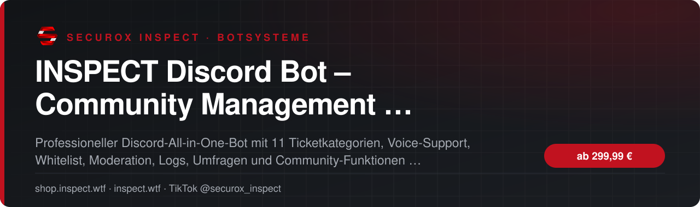
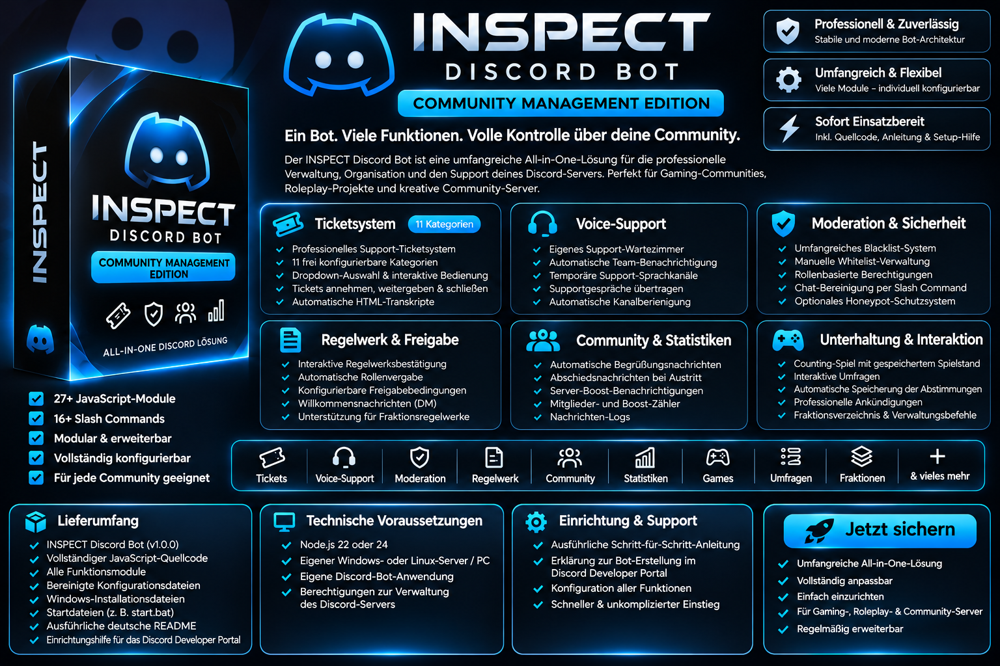

<!-- inspect-showcase: automatisch erzeugt, Änderungen bitte im Shop vornehmen -->

  
  
  
  

  
  
  

 

> 🇬🇧 **English:** INSPECT Discord Bot – Community Management Edition Open Source – Discord bot for community management by SecuroX Inspect. Purchase and licensing exclusively at [shop.inspect.wtf](https://shop.inspect.wtf). Product details below are in German – questions are welcome on [Discord](https://discord.gg/inspect).

 

## Das Wichtigste auf einen Blick

<table>
  <tr>
    <td width="50%" valign="top">✔&nbsp; <b>All-in-One Discord-Bot für Community-, Gaming- und Rollenspiel-Server</b></td>
    <td width="50%" valign="top">✔&nbsp; <b>Ticketsystem mit 11 Kategorien, Dropdown-Auswahl und Ticketverwaltung</b></td>
  </tr>
  <tr>
    <td width="50%" valign="top">✔&nbsp; <b>Tickets annehmen, weitergeben sowie Mitglieder hinzufügen und entfernen</b></td>
    <td width="50%" valign="top">✔&nbsp; <b>Geschlossene Tickets und HTML-Transkripte zur Dokumentation</b></td>
  </tr>
</table>

## Überblick

INSPECT Discord Bot – Community Management Edition 1.0.0: ein umfangreiches, selbst hostbares Discord-Verwaltungssystem für Communitys, Gaming-Projekte und Rollenspiel-Server. Statt mehrere einzelne Bots einzurichten, bündelst du zentrale Abläufe in einer Lösung. Das Ticketsystem bietet elf Kategorien, ein interaktives Auswahlmenü, Team-Zuweisung, Übergabe, Verwaltung von Ticketmitgliedern, Abschluss und HTML-Transkripte. Für persönlichen Support stehen ein Sprach-Wartezimmer, Team-Benachrichtigungen und automatisch erstellte temporäre Sprachkanäle zur Verfügung. Weitere Module umfassen Regelwerksbestätigung mit Rollenfreigabe, manuelle Whitelist, Blacklist und Synchronisierung, Moderationsbefehle, Begrüßung und Verabschiedung, Boost-Informationen, Mitglieder- und Boost-Zähler, Nachrichtenprotokolle, Counting-Spiel, Abstimmungen, Ankündigungen und ein Fraktionsverzeichnis. Ein optionales Honeypot-Modul kann nach sorgfältiger Einrichtung separat aktiviert werden. Enthalten sind der JavaScript-Quellcode, bereinigte Konfigurationsdateien, Windows-Installations- und Startdateien sowie eine verständliche deutsche Schritt-für-Schritt-Anleitung für die Einrichtung im Discord Developer Portal und auf deinem eigenen Server. Technische Basis: Node.js und discord.js v14; der Bot wird auf einem eigenen PC, VPS oder Root-Server betrieben. Du erstellst deine eigene Discord-Anwendung und hinterlegst die IDs deiner Serverrollen und Kanäle. Wichtig: Kein Hosting, keine browserbasierte Administrationsoberfläche und keine automatische Einrichtung mehrerer Discord-Server in einer Instanz. Es handelt sich nicht um eine FiveM-Server-Whitelist oder Shop-/API-Integration. Einige Funktionen benötigen passende Kanäle, Rollen und Berechtigungen und müssen vor der Nutzung konfiguriert werden. Die Version wurde lokal auf Syntax und Modulaufbau geprüft; ein vollständiger Live-Test auf deinem Discord ist vor dem Produktiveinsatz erforderlich.

## Kompatibilität

| | |
|:--|:--|
| Plattform | FiveM (GTA V) |

## Alle weiteren Funktionen

- Voice-Support: Wartezimmer, Team-Benachrichtigung und temporäre Sprachkanäle
- Regelwerk mit Bestätigung und rollenbasierter Freigabe
- Manuelle Whitelist und umfangreiches Blacklist-System inklusive Synchronisierung
- Moderation über Slash Commands, unter anderem /clearchat
- Automatische Willkommens-, Abschieds- und Boost-Nachrichten
- Nachrichten-Logs sowie Mitglieder- und Boost-Zähler
- Counting-Spiel mit gespeicherten Spielständen
- Interaktive Umfragen mit Speicherung der Stimmen
- Ankündigungen über /post und öffentliches Fraktionsverzeichnis
- Optionales Honeypot-Modul (standardmäßig deaktiviert)

<b>6 weitere Funktionen anzeigen</b>

- Deutsche Installationsanleitung inklusive Discord Developer Portal
- Vollständiger JavaScript-Quellcode und Konfigurationsvorlagen
- Einfaches Self-Hosting mit Node.js und discord.js v14
- Einmaliger Produktpreis – Hosting und individuelle Einrichtung nicht enthalten, Optional Buchbar
- Pro Bot-Instanz für einen konfigurierten Discord-Server ausgelegt
- Keine Web-Dashboard- oder FiveM-API-Funktionen enthalten

## Preis

| Paket | Leistungsumfang | Preis |
|:--|:--|--:|
| **VOLLVERSION** | Komplettpaket mit Quellcode, allen enthaltenen Modulen und deutscher Installationsanleitung – zur Selbstinstallation. | **299,99 €** |

Sichere Zahlung mit PayPal oder Kreditkarte · Rechnung als PDF · Support auf Deutsch

## So einfach geht's

1. **Im Shop kaufen** – sicher bezahlen mit PayPal oder Kreditkarte.
2. **Sofort loslegen** – Download und Lizenz stehen direkt nach Zahlungseingang in deinem Kundenkonto bereit, die Rechnung erhältst du als PDF.
3. **Einrichten** – bei Fragen hilft dir unser Support im Discord weiter.

## Warum INSPECT?

<table>
  <tr>
    <td width="50%" valign="top"><b>🇩🇪 Entwickelt in Deutschland</b> Konzeption, Entwicklung und Support aus einer Hand.</td>
    <td width="50%" valign="top"><b>💬 Persönlicher Support</b> Schnelle Hilfe auf Deutsch im INSPECT Discord.</td>
  </tr>
  <tr>
    <td width="50%" valign="top"><b>🔒 Sichere Zahlung</b> PayPal oder Kreditkarte, Rechnung automatisch als PDF.</td>
    <td width="50%" valign="top"><b>⚡ Sofort verfügbar</b> Download und Lizenz direkt nach der Zahlung im Kundenkonto.</td>
  </tr>
</table>

## Häufige Fragen

<b>Wie erhalte ich das Produkt?</b>

 

Nach bestätigter Zahlung stehen Download und Lizenz in deinem Kundenkonto bereit. Die Rechnung erhältst du als PDF.

<b>Bekomme ich Hilfe bei der Einrichtung?</b>

 

Ja – unser Support hilft dir im [INSPECT Discord](https://discord.gg/inspect) persönlich und auf Deutsch.

<b>Wo kaufe ich offiziell?</b>

 

Ausschließlich im INSPECT Shop unter [shop.inspect.wtf](https://shop.inspect.wtf). Angebote von Dritten stammen nicht von uns.

## Kontakt

| | |
|:--|:--|
| 🛒 Shop | [shop.inspect.wtf](https://shop.inspect.wtf) |
| 🌐 Website | [inspect.wtf](https://inspect.wtf) |
| 💬 Discord | [discord.gg/inspect](https://discord.gg/inspect) |
| 🎬 TikTok | [@securox_inspect](https://www.tiktok.com/@securox_inspect) |
| ✉️ E-Mail | [info@inspect.wtf](mailto:info@inspect.wtf) |

---

<b>SecuroX Inspect</b> · Offizielle Produktpräsentation · Dieses Repository enthält keinen Quellcode und keine Produktdateien. 
Kauf und Lizenzen ausschließlich über <a href="https://shop.inspect.wtf">shop.inspect.wtf</a> · Inhalte werden automatisch aus dem Shop aktualisiert.

